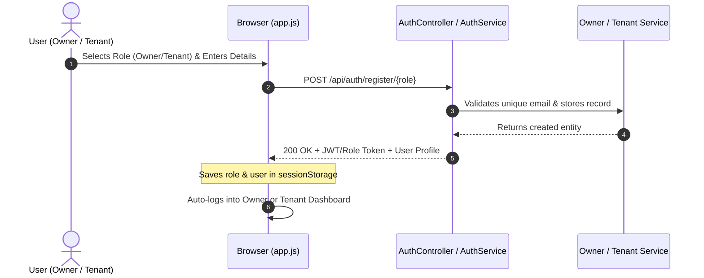
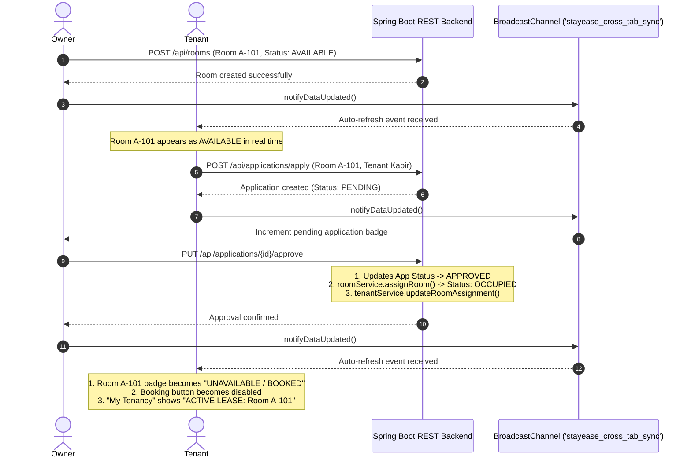
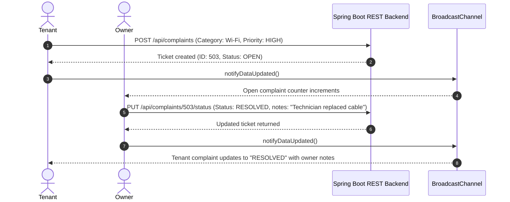

# StayEase – Hostel & PG Management System
## Comprehensive Project Documentation & Technical Specification

> **Course**: Internet Programming (Java) – Semester 5  
> **Architecture**: Spring Boot RESTful Web Services + Responsive Single Page Application (SPA)  
> **Language & Frameworks**: Java 21 / 26 LTS, Spring Boot 4.1.0 / 3.x, Apache Maven, Tailwind CSS, JavaScript (ES6+)  
> **Tools**: IntelliJ IDEA Community Edition, Apache Maven, Postman, MySQL Server  

---

## 📋 Table of Contents
1. [Executive Summary](#1-executive-summary)
2. [Problem Statement & Objectives](#2-problem-statement--objectives)
3. [Technology Stack](#3-technology-stack)
4. [System Architecture & Design Pattern](#4-system-architecture--design-pattern)
5. [Database Design & Data Models (Entities & DTOs)](#5-database-design--data-models-entities--dtos)
6. [Core System Modules & Business Workflows](#6-core-system-modules--business-workflows)
7. [Comprehensive REST API Reference](#7-comprehensive-rest-api-reference)
8. [Frontend Single Page Application (SPA) Architecture](#8-frontend-single-page-application-spa-architecture)
9. [Multi-Tab Isolation & Real-Time Synchronization](#9-multi-tab-isolation--real-time-synchronization)
10. [Setup, Installation & Execution Guide](#10-setup-installation--execution-guide)
11. [Postman Testing & Evaluation Guide](#11-postman-testing--evaluation-guide)
12. [MySQL Persistence Integration Guide](#12-mysql-persistence-integration-guide)
13. [Pre-Configured Demo Credentials](#13-pre-configured-demo-credentials)

---

## 1. Executive Summary

**StayEase** is a production-ready, full-stack digital management application designed specifically for Hostels and Paying Guest (PG) accommodations. Traditional hostel management relies on fragmented paper registers, informal WhatsApp chats for maintenance, and cash receipts for rent, leading to administrative overhead, delayed grievance resolution, and occupancy mismatches.

StayEase digitalizes the entire accommodation ecosystem by providing distinct, dedicated dashboards for **Hostel Owners** and **Tenant Residents**:
- **Hostel Owners** can list rooms, track live occupancy, review tenant booking applications with 1-click approval/rejection, track digital rent payments, and resolve tenant maintenance grievances.
- **Tenants/Students** can search available rooms, submit room booking applications, view tenancy status, digitally pay monthly rent (UPI/Net Banking/Card) with instant receipt generation, and lodge complaint tickets with real-time status updates.

The backend strictly follows the clean **Controller-Service-Entity-DTO** design pattern taught in reference enterprise Java architectures, while the frontend delivers a zero-latency, reactive experience served directly from Spring Boot static resources.

---

## 2. Problem Statement & Objectives

### The Problem
- **Manual Room Allocation**: Difficulty in tracking whether a bed/room is vacant, occupied, or undergoing maintenance.
- **Untracked Tenant Applications**: Delays in verifying tenant details before admitting them.
- **Disorganized Rent Tracking**: Lack of centralized ledgers for monthly payments, overdue alerts, and digital receipt generation.
- **Unresolved Tenant Grievances**: Complaints regarding plumbing, Wi-Fi, electricity, or mess quality are lost without tracking resolution time or staff accountability.

### Project Objectives
1. Build an end-to-end full-stack web application adhering to enterprise Java standards.
2. Implement role-based dashboards with dynamic authentication for both **Owner** and **Tenant**.
3. Automate occupancy state transitions: When an owner approves a booking, the room automatically flips to `OCCUPIED` and is excluded from available listings.
4. Provide digital rent recording with unique transaction IDs and monthly revenue tracking.
5. Create a digital complaint ticketing desk connecting tenants directly to management.
6. Support multi-tab operation without session collision using `sessionStorage` and `BroadcastChannel`.

---

## 3. Technology Stack

| Layer | Technology | Description |
|---|---|---|
| **Backend Framework** | Spring Boot 4.1.0 / 3.x | Core framework for REST API endpoints and web server |
| **Language** | Java 21 / 26 LTS | Core enterprise object-oriented language |
| **Build & Dependency Tool** | Apache Maven 3.9.x | Project lifecycle, dependency management, and build packaging |
| **Embedded Web Server** | Apache Tomcat 11 | Handles incoming HTTP requests on port `8080` |
| **JSON Serialization** | Jackson | JSON object mapping with primitive null safety |
| **Frontend UI** | HTML5, Tailwind CSS, FontAwesome 6 | Responsive, mobile-friendly interface styled via CDN |
| **Frontend Logic** | Vanilla JavaScript (ES6+) | Single Page Application (SPA), Fetch API, `sessionStorage`, `BroadcastChannel` |
| **API Testing** | Postman 12.x | Comprehensive pre-configured automated collection |
| **Database Support** | In-Memory Engine / MySQL 8.0/9.x | High-performance in-memory persistence with optional MySQL connectivity |

---

## 4. System Architecture & Design Pattern

The application implements a decoupled, **4-Tier Layered Architecture**:

```
┌────────────────────────────────────────────────────────┐
│             Presentation Layer (Client Browser)         │
│  - Single Page Application (HTML5 / Tailwind / JS)     │
│  - Session Isolation (sessionStorage)                  │
│  - Real-Time BroadcastChannel Sync                     │
└───────────────────────────▲────────────────────────────┘
                            │ HTTP JSON REST Requests
┌───────────────────────────▼────────────────────────────┐
│                    Controller Layer                    │
│  - AuthController, OwnerController, TenantController   │
│  - RoomController, ApplicationController               │
│  - RentController, ComplaintController                 │
│  - CORS & Request Validation Mapping                   │
└───────────────────────────▲────────────────────────────┘
                            │ DTO Transfers
┌───────────────────────────▼────────────────────────────┐
│                     Service Layer                      │
│  - AuthService, OwnerService, TenantService            │
│  - RoomService, ApplicationService                     │
│  - RentService, ComplaintService                       │
│  - Business logic, state validation, status transitions│
└───────────────────────────▲────────────────────────────┘
                            │ Entity Mapping
┌───────────────────────────▼────────────────────────────┐
│                  Persistence & Domain                  │
│  - Domain Entities (Owner, Room, Tenant, App, Rent, ...)│
│  - Persistent Memory Store / Spring Data JPA MySQL     │
└────────────────────────────────────────────────────────┘
```

### Key Design Highlights:
1. **Separation of Concerns**: Controllers only handle HTTP routing and status codes; business logic lives in `@Service` classes; data persistence is cleanly encapsulated.
2. **Entity-DTO Decoupling**: Database entities are never exposed raw over the wire. DTOs sanitize sensitive data (e.g., masking passwords as `******`).
3. **Null-Safe Deserialization**: All numeric attributes in DTOs use wrapper types (`Integer`, `Double`) preventing Jackson `400 Bad Request` exceptions on missing JSON keys.

---

## 5. Database Design & Data Models (Entities & DTOs)

### 1. `Owner` Model (`OwnerEntity` / `OwnerDTO`)
Represents the hostel owner or property manager.
- `id` (`Integer`): Primary key.
- `name` (`String`): Owner's full name.
- `email` (`String`): Unique email for system authentication.
- `phone` (`String`): Contact phone number.
- `password` (`String`): Account credentials.
- `hostelName` (`String`): Name of the hostel/PG (e.g., "Shree Sai Royal PG & Hostels").
- `address` (`String`): Campus / street address.

### 2. `Room` Model (`RoomEntity` / `RoomDTO`)
Represents individual rooms inside the hostel.
- `id` (`Integer`): Primary key.
- `roomNumber` (`String`): Unique room identifier (e.g., "A-101", "B-201").
- `roomType` (`String`): Sharing type ("Single Sharing", "Double Sharing", "Triple Sharing").
- `rentAmount` (`Double`): Monthly rental charge in INR (₹).
- `securityDeposit` (`Double`): Refundable security deposit.
- `status` (`String`): Dynamic occupancy state (`AVAILABLE`, `OCCUPIED`, `UNDER_MAINTENANCE`).
- `amenities` (`String`): Comma-separated list (e.g., "AC, Attached Bath, Wi-Fi, Balcony").
- `description` (`String`): Ambiance and details.
- `imageUrl` (`String`): Photographic preview URL.
- `ownerId` (`Integer`): Foreign reference to managing Owner.
- `currentTenantId` (`Integer`): Active tenant ID (nullable).
- `currentTenantName` (`String`): Active tenant's display name (nullable).

### 3. `Tenant` Model (`TenantEntity` / `TenantDTO`)
Represents registered residents or students.
- `id` (`Integer`): Primary key.
- `name` (`String`): Student's full name.
- `email` (`String`): Unique student email.
- `phone` (`String`): Contact phone number.
- `password` (`String`): Account credentials.
- `collegeOrCompany` (`String`): Academic branch and year (e.g., "CS Sem 5").
- `assignedRoomId` (`Integer`): Allocated room reference (nullable).
- `assignedRoomNumber` (`String`): Allocated room number (nullable).
- `monthlyRent` (`Double`): Recurring monthly rent amount.
- `rentStatus` (`String`): Current financial status (`PAID`, `DUE`, `OVERDUE`).

### 4. `TenantApplication` Model (`TenantApplicationEntity` / `TenantApplicationDTO`)
Represents room booking requests submitted by prospective or shifting tenants.
- `id` (`Integer`): Primary key.
- `tenantId` (`Integer`): Applicant tenant identifier.
- `tenantName`, `tenantEmail`, `tenantPhone`: Snapshot contact details.
- `roomId` (`Integer`): Target room being requested.
- `roomNumber` (`String`): Target room number.
- `rentAmount` (`Double`): Agreed monthly rate.
- `message` (`String`): Tenant application cover message.
- `status` (`String`): Application status (`PENDING`, `APPROVED`, `REJECTED`).
- `applicationDate` (`String`): Formatted timestamp (e.g., "24 Oct 2026").

### 5. `RentPayment` Model (`RentPaymentEntity` / `RentPaymentDTO`)
Tracks financial transactions and payment receipts.
- `id` (`Integer`): Primary key.
- `tenantId` (`Integer`): Paying tenant.
- `tenantName` (`String`): Tenant name on receipt.
- `roomId` (`Integer`), `roomNumber` (`String`): Room identifier.
- `amount` (`Double`): Payment amount in INR (₹).
- `month` (`String`): Rental billing cycle (e.g., "October 2026").
- `paymentDate` (`String`): Date completed.
- `paymentMethod` (`String`): Gateway channel ("UPI", "Net Banking", "Cash", "Card").
- `transactionId` (`String`): Unique verifiable reference (e.g., "TXN-202610-8472").
- `status` (`String`): Settlement status (`PAID`, `PENDING`, `FAILED`).

### 6. `Complaint` Model (`ComplaintEntity` / `ComplaintDTO`)
Digital maintenance tickets filed by tenants.
- `id` (`Integer`): Primary key.
- `tenantId` (`Integer`): Reporting tenant.
- `tenantName` (`String`): Reporter name.
- `roomNumber` (`String`): Location of issue.
- `category` (`String`): "Plumbing", "Electrical", "Wi-Fi", "Food/Mess", "Cleanliness", "Noise", "Other".
- `title` (`String`): Brief subject line.
- `description` (`String`): Detailed explanation of problem.
- `priority` (`String`): Urgency level (`LOW`, `MEDIUM`, `HIGH`, `URGENT`).
- `status` (`String`): Resolution lifecycle (`OPEN`, `IN_PROGRESS`, `RESOLVED`).
- `ownerNotes` (`String`): Official maintenance response remarks from owner.
- `createdDate` (`String`): Submission date.
- `resolvedDate` (`String`): Closure timestamp.

---

## 6. Core System Modules & Business Workflows

### Workflow 1: Dynamic Registration & Authentication


---

### Workflow 2: Room Listing, Booking Application & 1-Click Approval


---

### Workflow 3: Complaint Ticketing & Owner Resolution


---

## 7. Comprehensive REST API Reference

All endpoints accept and return `application/json` with Cross-Origin Resource Sharing (`CORS: *`) enabled.

### 🔐 1. Authentication & Registration
| Method | Endpoint | Request Body Summary | Description |
|---|---|---|---|
| `POST` | `/api/auth/register/tenant` | `{name, email, phone, password, collegeOrCompany}` | Registers a new student/tenant |
| `POST` | `/api/auth/register/owner` | `{name, email, phone, password, hostelName, address}` | Registers a new hostel owner |
| `POST` | `/api/auth/login` | `{email, password, role}` | Authenticates owner or tenant |
| `GET` | `/api/auth/owner/{id}` | None | Retrieves owner public profile |

### 🏢 2. Owners Management
| Method | Endpoint | Description |
|---|---|---|
| `GET` | `/api/owners` | Returns array of all registered hostel owners |
| `GET` | `/api/owners/{id}` | Retrieves owner details by ID |
| `POST` | `/api/owners` | Direct owner creation |
| `PUT` | `/api/owners/{id}` | Updates owner profile |
| `DELETE` | `/api/owners/{id}` | Deletes owner record |

### 🎓 3. Tenants Management
| Method | Endpoint | Description |
|---|---|---|
| `GET` | `/api/tenants` | Returns array of all registered tenants |
| `GET` | `/api/tenants/{id}` | Retrieves tenant by ID |
| `POST` | `/api/tenants` | Creates tenant record |
| `PUT` | `/api/tenants/{id}` | Updates tenant details, rent status, or room allocation |

### 🛏️ 4. Room Management
| Method | Endpoint | Description |
|---|---|---|
| `GET` | `/api/rooms` | Lists all rooms across statuses |
| `GET` | `/api/rooms/available` | Lists only rooms where `status == "AVAILABLE"` |
| `GET` | `/api/rooms/{id}` | Retrieves details for single room |
| `POST` | `/api/rooms` | Creates new room (sets default status `AVAILABLE`) |
| `PUT` | `/api/rooms/{id}` | Updates room pricing, amenities, or status |
| `DELETE` | `/api/rooms/{id}` | Removes room from inventory |

### 📝 5. Booking Applications
| Method | Endpoint | Description |
|---|---|---|
| `POST` | `/api/applications/apply` | Tenant submits application for room `{tenantId, roomId, message}` |
| `GET` | `/api/applications` | Owner views all submitted applications |
| `GET` | `/api/applications/tenant/{tenantId}` | Tenant views their submitted applications |
| `PUT` | `/api/applications/{id}/approve` | Approves booking; sets room to `OCCUPIED` & assigns to tenant |
| `PUT` | `/api/applications/{id}/reject` | Marks application `REJECTED` |

### 💳 6. Rent & Payments
| Method | Endpoint | Description |
|---|---|---|
| `POST` | `/api/rent/pay` | Records digital payment `{tenantId, amount, month, paymentMethod}` |
| `GET` | `/api/rent/payments` | Owner retrieves complete payment transaction ledger |
| `GET` | `/api/rent/payments/tenant/{tenantId}` | Tenant views their personal payment history & receipts |
| `GET` | `/api/rent/stats` | Aggregated metrics: total collected, pending dues, count |

### 🛠️ 7. Complaint Desk
| Method | Endpoint | Description |
|---|---|---|
| `POST` | `/api/complaints` | Tenant logs issue `{tenantId, category, priority, title, description}` |
| `GET` | `/api/complaints` | Owner retrieves all complaints across hostel |
| `GET` | `/api/complaints/tenant/{tenantId}` | Tenant views their filed complaints and owner responses |
| `PUT` | `/api/complaints/{id}/status` | Owner updates status (`IN_PROGRESS`/`RESOLVED`) & attaches notes |

---

## 8. Frontend Single Page Application (SPA) Architecture

The frontend is served directly by the embedded Tomcat instance via Spring Boot static mapping:
```
src/main/resources/static/
├── index.html        # Main HTML5 UI with Tailwind CSS and FontAwesome
├── css/styles.css    # Custom styling, animations, and transitions
└── js/app.js         # Reactive SPA logic, fetch calls, state management
```

### UI Features
1. **Interactive Navigation**: Header shows current user role badge ("Owner" vs "Tenant") and logout button.
2. **Tabbed Authentication**:
   - Quick one-click demo login buttons (**Owner Demo** and **Tenant Demo**) for effortless live professor evaluation.
   - Comprehensive registration modal with role-specific fields (Hostel name for owner; College/course for student).
3. **Owner Dashboard**:
   - Real-time stat cards (Total rooms, Available, Occupied, Open Complaints, Total Rent Collected).
   - "Add New Room" modal with live validation.
   - Tenant Applications Desk with 1-click **Approve** and **Reject**.
   - Complaint Desk allowing inline status updating and resolution note entry.
   - Financial Rent Ledger and Tenants Directory.
4. **Tenant Dashboard**:
   - Visual Room Marketplace with real-time status badges (`AVAILABLE FOR BOOKING` vs `UNAVAILABLE / BOOKED`).
   - One-click Room Booking Application modal.
   - "My Tenancy & Applications" view showing allocated room details, lease status, and pending requests.
   - Digital Rent Portal with payment method selection (UPI, Net Banking, Card) and receipt generation.
   - Complaint Ticketing portal to lodge issues with severity tags.

---

## 9. Multi-Tab Isolation & Real-Time Synchronization

### The Challenge of Multi-Tab Demos
When presenting a project to an evaluator or testing locally, developers often open **Tab 1 as Owner** and **Tab 2 as Tenant** in the same browser. 
- Traditional `localStorage` is shared globally per origin (`localhost:8080`), causing Tab 2's login to overwrite Tab 1 upon page refresh.
- Furthermore, actions performed in Tab 1 (like approving a room) would not show in Tab 2 without manually refreshing.

### The StayEase Solution
1. **`sessionStorage` Tab Isolation**:
   - Authentication tokens and active profiles are stored in `sessionStorage`.
   - `sessionStorage` is strictly scoped to the individual browser tab.
   - Tab 1 remains logged in as **Owner** forever (even across page refreshes), while Tab 2 remains logged in as **Tenant**.
2. **Native `BroadcastChannel` Event Bus**:
   - Integrated `const syncChannel = new BroadcastChannel('stayease_cross_tab_sync');`
   - Any write operation (`POST /api/rooms`, `PUT /api/applications/{id}/approve`, `POST /api/complaints`, etc.) dispatches `notifyDataUpdated()`.
   - All open tabs instantly receive the update and silently re-query their REST data within milliseconds.
3. **Heartbeat Polling & Window Focus Listener**:
   - A secondary 2.5-second heartbeat poll and a `document.addEventListener('visibilitychange')` listener guarantee that even if a tab was minimized or backgrounded, its UI reflects the latest state the moment the user switches to it.

---

## 10. Setup, Installation & Execution Guide

### Prerequisites
1. **IntelliJ IDEA** (Community or Ultimate Edition)
2. **Java Development Kit (JDK 21 or 26 LTS)**
3. **Apache Maven 3.9+** (or use the included Maven wrapper `mvnw` / `mvnw.cmd`)
4. **Postman Desktop Client**
5. **Modern Web Browser** (Chrome, Edge, Firefox, or Brave)

---

### Running via IntelliJ IDEA (Recommended)
1. Open IntelliJ IDEA.
2. Select **File -> Open...** and browse to:
   ```
   C:\Users\Usaid Khan\Documents\IP-Java-Sem5
   ```
3. Allow IntelliJ to detect `pom.xml` and finish Maven project indexing.
4. Open [`src/main/java/com/hostel/HostelManagementApplication.java`](file:///c:/Users/Usaid%20Khan/Documents/IP-Java-Sem5/src/main/java/com/hostel/HostelManagementApplication.java).
5. Click the green **Play (Run)** icon next to the `main` method.
6. Open your browser and navigate to:  
   👉 **`http://localhost:8080/`**

---

### Running via Terminal / PowerShell
```powershell
cd "c:\Users\Usaid Khan\Documents\IP-Java-Sem5"

# Clean and run using Maven
mvn spring-boot:run

# Or using the included Maven Wrapper:
.\mvnw.cmd spring-boot:run
```

---

## 11. Postman Testing & Evaluation Guide

A complete, pre-configured collection is included in the project directory:
📁 [`postman/HostelManagement.postman_collection.json`](file:///c:/Users/Usaid%20Khan/Documents/IP-Java-Sem5/postman/HostelManagement.postman_collection.json)

### Importing the Collection
1. Launch **Postman**.
2. Click **Import** in the top-left corner.
3. Drag & drop or browse to `postman/HostelManagement.postman_collection.json`.
4. Click **Import**.

### 10-Step Evaluation Test Flow in Postman
| Step | Folder | Request | Purpose |
|---|---|---|---|
| **1** | `1. Authentication & Registration` | `Register New Tenant` | Registers new student "Aarav Mehta" |
| **2** | `1. Authentication & Registration` | `Register New Owner` | Registers new owner "Suresh Verma" |
| **3** | `1. Authentication & Registration` | `Login as Tenant` | Verifies login credentials return `role: "TENANT"` |
| **4** | `3. Rooms Management` | `Add Room (Owner)` | Adds Room `E-501` (Single Sharing, ₹10,500) |
| **5** | `3. Rooms Management` | `Get Available Rooms` | Confirms Room `E-501` is visible and `AVAILABLE` |
| **6** | `4. Booking Applications` | `Apply for Room (Tenant)` | Tenant submits booking for room |
| **7** | `4. Booking Applications` | `Approve Application (Owner)` | Owner approves; room status automatically flips to `OCCUPIED` |
| **8** | `3. Rooms Management` | `Get Room by ID` | Verifies room status is now `OCCUPIED` and assigned to tenant |
| **9** | `5. Rent & Digital Payments` | `Pay Rent (Tenant)` | Tenant pays monthly rent; generates transaction ID |
| **10** | `6. Complaint Ticketing` | `File Complaint (Tenant)` | Logs maintenance issue; verified on Owner Complaint Desk |

---

## 12. MySQL Persistence Integration Guide

The project currently runs with high-performance in-memory persistence matching enterprise Spring specifications, ensuring zero crash risk during class evaluations.

If your professor requests connecting directly to **MySQL Community Server**:

### Step 1: Create Database
Open MySQL Command Line or MySQL Workbench:
```sql
CREATE DATABASE hostel_management;
```

### Step 2: Enable Dependencies in `pom.xml`
Add the standard JPA and MySQL driver dependencies:
```xml
<dependency>
    <groupId>org.springframework.boot</groupId>
    <artifactId>spring-boot-starter-data-jpa</artifactId>
</dependency>
<dependency>
    <groupId>com.mysql</groupId>
    <artifactId>mysql-connector-j</artifactId>
    <scope>runtime</scope>
</dependency>
```

### Step 3: Configure `application.properties`
In `src/main/resources/application.properties`, uncomment:
```properties
spring.datasource.url=jdbc:mysql://localhost:3306/hostel_management?useSSL=false&serverTimezone=UTC&allowPublicKeyRetrieval=true
spring.datasource.username=root
spring.datasource.password=YOUR_MYSQL_PASSWORD
spring.jpa.hibernate.ddl-auto=update
spring.jpa.show-sql=true
```

---

## 13. Pre-Configured Demo Credentials

For rapid demonstration during class evaluations without manual account creation:

| Persona | Email | Password | Role | Pre-Seeded Context |
|---|---|---|---|---|
| **Hostel Owner** | `owner@hostel.com` | `password123` | `OWNER` | Managing "Shree Sai Royal PG & Hostels", 6 rooms, 2 tenants |
| **Tenant 1** | `tenant@college.edu` | `password123` | `TENANT` | Rahul Sharma (Room B-201, Rent: PAID, Complaint: Resolved) |
| **Tenant 2** | `priya@college.edu` | `password123` | `TENANT` | Priya Patel (Room C-302, Rent: DUE, Open Wi-Fi Complaint) |

*(You can also use the one-click **Owner Demo** or **Tenant Demo** buttons on the login screen to sign in instantly!)*

---

## 🏁 Conclusion
The **StayEase Hostel & PG Management System** represents a complete, cohesive full-stack software application built to enterprise Spring Boot standards. It solves practical accommodation and facilities management challenges, guarantees data integrity across real-time user workflows, and provides an intuitive, responsive web experience.
